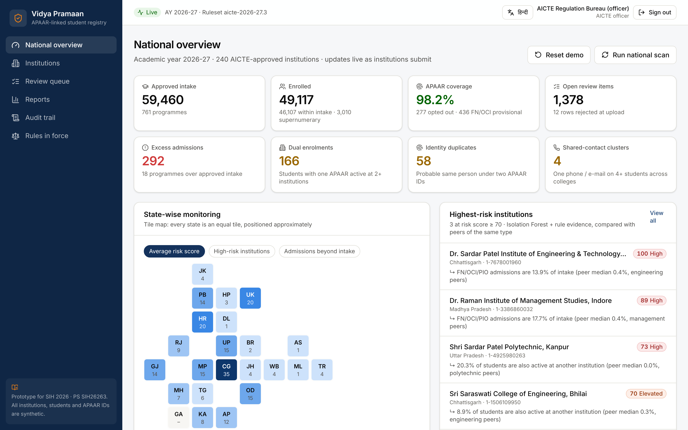

# Vidya Pramaan

**APAAR ID-based student data management and verification platform for AICTE-approved institutions.**
Prototype for Smart India Hackathon 2026, problem statement **SIH26263** (AICTE, Regulation Bureau · Software · Smart Automation). Team **AI Riders**.

> One student. One APAAR ID. One verifiable record.

Live demo: **https://vidya-pramaan-sih26263.onrender.com** (free instance: the first visit after a quiet spell can take up to a minute to wake).
Demo video (5 min, narrated, captioned): **https://youtu.be/eBwySqMs63Q**. It is regenerated from the app by the scripts in [`video/`](video/).

All institutions, students and APAAR IDs in this repository are **synthetic**. Nothing here connects to a real APAAR, DigiLocker or AICTE system.



## Why it exists

NAD/DigiLocker already verifies degrees with the student's consent, ABC holds credits and AISHE publishes aggregate statistics two to three years late. What AICTE does not have is a **near-real-time, student-level view that reconciles every admission against approved intake and catches the same student enrolled twice**. Excess admission costs an institution five times the fee per excess student (*FORE School of Management v AICTE*, 2019), so evidence has to be right. Vidya Pramaan is that reconciliation and verification layer. It consumes APAAR, does not replace it, and produces the APAAR-linked records that NAD/ABC and AISHE expect.

## What it does

Institution → student data upload → APAAR validation → data verification → AICTE central repository → analytics & monitoring → authorised verification

| PS requirement | Where it lives in the prototype |
|---|---|
| 1. Secure upload/update API keyed on APAAR | Excel / CSV upload, with ERP column names recognised automatically; re-uploads show a field-by-field correction preview; `POST /api/v1/students:validate` and `:submit` with per-institution API keys and idempotency keys |
| 2. Intake, enrolment, supernumerary, NRI, OCI, FN fields | Upload template; per-programme seat ledger; supernumerary caps by programme level from the 2026-27 rules file |
| 3. Automated validation (duplicates, invalid/missing APAAR, excess intake, inconsistencies, cross-institution duplicates) | `validation.py` (31 rule codes) + `scan.py` (national scan: dual enrolment, identity duplicates, shared-contact clusters, intake overruns) |
| 4. Real-time dashboards for AICTE and institutions | AICTE national overview and institution overview, updated live over Server-Sent Events |
| 5. Secure verification for AICTE, institutions, employers and other regulators | Public QR check (also on the device, offline); consent-based verification with OTP; state-regulator role; university role |
| 6. Verifiable student records | W3C-style credential signed with Ed25519 and a compact signed QR; credentials are superseded on correction and revoked on exit |
| 7. Integration with existing systems | REST API with OpenAPI at `/docs`; registry adapter for DigiLocker / API Setu; signed audit checkpoints anyone can archive |
| 8. Security, privacy, RBAC, audit, consent | 7 roles; masked IDs; explicit consent (never assumed); student-visible access log; hash-chained audit with signed checkpoints. See [docs/SECURITY.md](docs/SECURITY.md) |
| 9. Reports | Excess-intake CSV, state summary XLSX (with the ruleset used), per-institution evidence pack for review or show-cause |
| 10. APAAR ID + student ID on certificates | University degree-print feed (APAAR ID + roll number + verification QR); certificate PDF; `GET /api/v1/certificate-data/{id}` |

### Design choices that matter

- **Regulatory numbers are data, not code.** `backend/app/rules/aicte_2026_27.json` holds the 2026-27 caps (FN/OCI/PIO 15% UG, 25% PG per the 2026-27 handbook addendum), the admission window and the penalty rule, each with its source and a `verified` flag. A circular is a new file, not a release. The rules are shown in the app under *Rules in force*.
- **Identity matching built for Indian names.** Spelling variants match: Mohd/Mohammed, Laxmi/Lakshmi, V S Krishna/Venkata Sai Krishna, honorifics, day/month swaps, Devanagari and Tamil text. Twins and rhyming siblings (Rohit/Mohit) do not, because a changed letter in a given name never matches. On a held-out, hand-labelled set the matcher reaches precision 0.79 and recall 0.92; the plain fuzzy matcher it replaced scored 0.65 and 0.68 (`python -m scripts.identity_eval`).
- **Decisions are remembered.** Every finding has a fingerprint. An officer's resolved, dismissed or escalated decision (a reason is required) is not re-opened by the next scan, and open items keep their IDs.
- **Nothing is silently changed.** A re-upload shows the before/after of every field. Identity changes (name, date of birth, gender) also raise a review item and replace the credential, so an old QR shows *superseded*.
- **The commit is re-validated.** If another batch took seats or added the same students after validation, submission re-checks against the data as it is then. Two batches cannot both claim seat #60.
- **Lifecycle.** Withdrawal, transfer out, drop-out and graduation are recorded, not deleted. The credential is revoked and duplicate-enrolment flags clear on the next scan. Continuing students (admitted in earlier years) are accepted without taking this year's seats.
- **Shared-contact clusters.** One mobile number or e-mail on four or more students across colleges (agent-filled or ghost admissions) is flagged and drawn as a graph. Siblings sharing a parent's phone are not.
- **Inclusive by design.** Students who decline APAAR and FN/OCI students get a provisional ID. A mother's or guardian's name is enough. Consent is recorded explicitly; a blank is flagged, never assumed.
- **Explainable risk.** An Isolation Forest plus rule evidence ranks institutions against peers of the same type, with the reasons shown. Scores order the review queue; they are not findings of wrongdoing.

## Quick start

Requires Python 3.11+ and Node 18+.

```bash
./run.sh                 # installs, seeds synthetic data, builds the UI, serves on :8000 (demo mode)
RESEED=1 ./run.sh        # start again from a fresh dataset
```

Open http://localhost:8000 and choose a demo user. API reference: http://localhost:8000/docs.

**Demo day tips**
- To repeat the walkthrough, sign in as the AICTE officer and press **Reset demo**. On the public site this needs the demo PIN (`VP_DEMO_PIN`). The reset undoes everything submitted through the portal; the audit trail is kept and records the reset.
- The tamper demonstrations on the Audit screen run on an in-memory copy, so visitors cannot leave the shared demo broken.
- To let judges scan the certificate QR with a phone on a local run, start the server with the laptop's address, for example `VP_PUBLIC_BASE_URL=http://192.168.1.20:8000 ./run.sh`.
- The app is installable (PWA). The QR verification page checks signatures on the device and still works without a connection.

Manual steps:

```bash
python3 -m venv .venv && .venv/bin/pip install -r backend/requirements.txt
cd frontend && npm install && npm run build && cd ..
cd backend && ../.venv/bin/python -m app.seed && VP_DEMO_MODE=1 ../.venv/bin/uvicorn app.main:app --port 8000
```

## Configuration

| Variable | Purpose |
|---|---|
| `VP_SECRET_KEY` | Signs sessions; the Ed25519 issuer key is derived from it (HKDF), so it stays the same across deploys. Required in any deployment. |
| `VP_ISSUER_KEY` | Optional: an explicit issuer key (PEM or base64 PEM), e.g. from a secrets manager. |
| `VP_DEMO_MODE` | `1` enables one-click demo sign-in, on-screen OTPs and demo reset. Off by default. |
| `VP_DEMO_PIN` | PIN required to reset the shared demo. |
| `VP_DATABASE_URL` | SQLite by default; PostgreSQL 16 is tested. |
| `VP_PUBLIC_BASE_URL` | Address printed in QR codes (Render's URL is picked up automatically). |
| `VP_RULES_FILE` | Ruleset for another academic year. |

## Deploy a public demo (free)

The repository includes a `Dockerfile` (UI + API in one container, synthetic data baked in) and a Render blueprint (`render.yaml`). The image contains no signing key: on first start the seeded credentials and audit checkpoints are re-signed with the key derived from `VP_SECRET_KEY`, and the rotation is written to the audit trail.

**Render (free plan):** New → Blueprint → pick this repository → Apply, then set `VP_DEMO_PIN` in the service's environment. **Any Docker host:** `docker build -t vidya-pramaan . && docker run -p 8000:8000 -e VP_SECRET_KEY=<random> -e VP_DEMO_MODE=1 -e VP_PUBLIC_BASE_URL=https://<your-host> vidya-pramaan`

## Seven roles, one demo script

| Sign in as | Try this |
|---|---|
| Institution admin | Overview → **Upload students** → *Try the demo file*: 77 rows, 65 accepted (6 with review flags), 12 returned with reasons. Submit; the AICTE dashboard updates live. Record a student's transfer under *Student records*. Create an ERP API key under *Integration API*. |
| AICTE officer | National overview → highest-risk institution → *Why this score* → **Evidence pack**. Review queue → `DUP-003` (matcher's reasons, side by side) → `DUP-004` (shared-contact graph) → decide with a reason. Audit trail → *Edit and recompute every hash*: the plain chain is fooled, the signed checkpoints are not. |
| University registrar | Degree & certificate feed: APAAR ID + student ID for each affiliated college, CSV for printing, QR issued on request. |
| State regulator (DTE) | Aggregated dashboard and reports for one state; no student-level screens. |
| Employer / verifier | Request consent for the student's APAAR (pick fields). |
| Student | Approve with the demo OTP; see the credential, the certificate PDF, and every access to the record. |
| Anyone (signed out) | Open the QR link: **Verified**, with the signature also checked on the device. Change one character and it fails. |

## Measured

`cd backend && python -m app.seed && python -m scripts.benchmark` → [`docs/benchmark.json`](docs/benchmark.json).

| Check | Result | What it means |
|---|---|---|
| Identity matching, held-out hand-labelled pairs | precision 0.79, recall 0.92 (previous matcher 0.65 / 0.68) | Independent of the synthetic data. Most remaining false alarms are records nobody can tell apart without an APAAR ID, which is why matches are review items |
| Same-day twins wrongly flagged | 0 of 80 | Hard negatives planted in the dataset |
| Planted dual enrolments / identity duplicates / contact clusters found | 164/164 · 57/57 · 4/4 | Regression checks on planted cases, not accuracy on real data |
| Planted anomalous institutions in the top-46 risk ranking | 42/46 | |
| Defect types caught in the demo upload | 17/17, with 0 false flags on 56 clean rows | |
| National scan over 49,053 enrolments | 1.6 s on one CPU, run in the background after each submission | Measured at 49k records; national scale (≈1 crore) is a pilot goal, not yet tested |

## Tests

```bash
cd backend && ../.venv/bin/python -m pytest -q --cov=app   # 65 tests on an isolated database, 93% line coverage
VP_DATABASE_URL=postgresql+psycopg://user:pw@host/db ../.venv/bin/python -m pytest -q   # same tests on PostgreSQL 16
cd backend && alembic upgrade head && alembic check        # versioned schema migrations (rollback: alembic downgrade -1)
cd e2e && npm install && npm test      # browser walkthrough of all 7 roles (server running on :8000)
cd e2e && npm run a11y                 # axe-core WCAG 2.1 AA check of 17 screens, desktop and phone
```

The browser walkthrough resets the demo, drives every role, fails on any browser console error, measures the live dashboard update, and saves the screenshots in `docs/screenshots/`. CI runs on every push: tests on SQLite and PostgreSQL with a coverage floor, migrations up, drift check, down and up again, bandit, pip-audit, npm audit, the browser walkthrough and the accessibility check. Results are summarised in [docs/SECURITY.md](docs/SECURITY.md#evidence-run-on-every-push-ci).

## Architecture

```
frontend/ (React + TypeScript + Tailwind + Recharts, installable PWA)
   │  REST + Server-Sent Events (60-second stream tickets, no tokens in URLs)
backend/app/
   main.py            FastAPI routes, RBAC, security headers, rate limits, reports, SPA hosting
   validation.py      row-level rule engine (31 rule codes), ERP column mapping, correction preview
   matching.py        identity matching for Indian names (twin-safe, transliteration-aware)
   scan.py            national scan with decision memory: intake, dual enrolment, identity, shared contacts
   anomaly.py         Isolation Forest + rule evidence → peer-relative institution risk with reasons
   rules/             regulatory parameters per academic year, with sources
   apaar_registry.py  registry adapter: mock now, DigiLocker / API Setu connector for production
   credentials.py     W3C-style credential + compact QR token, Ed25519, key derivation
   audit.py           hash-chained audit log, signed checkpoints, attack simulation
   keys.py            issuer key rotation (re-signs and records it)
   seed.py            synthetic national dataset with planted anomalies and hard negatives
```

Production path: PostgreSQL with row-level security and encrypted PII columns, AICTE SSO (OIDC + MFA), the DigiLocker / API Setu connector once AICTE is onboarded, hosting on MeitY-empanelled cloud or NIC, and STQC / CERT-In-empanelled audit before go-live.

## Not built yet (production work)

- Live APAAR lookups: the registry adapter uses a mock. Real lookups need AICTE to be onboarded as a DigiLocker / API Setu partner.
- AICTE SSO with MFA. The prototype uses signed demo sessions (8-hour expiry) and per-institution API keys.
- Cross-script matching (a Latin name against the same name in Devanagari) needs an Indic transliteration model; same-script Indic names are handled.
- Encrypted PII columns, row-level security and an external anchor (e.g. a public timestamping service) for audit checkpoints.
- Real OTP delivery. The demo shows the OTP on screen.
- Hindi covers navigation, headline labels and the sign-in page, not every screen.
- Supernumerary values marked `verified: false` in the rules file must be confirmed against the handbook in force.

More: [assumptions](docs/ASSUMPTIONS.md) · [data dictionary](docs/DATA_DICTIONARY.md) · [security and privacy](docs/SECURITY.md) · [claim-to-evidence map for the deck](docs/CLAIMS.md).

## Submission deck

`ppt/SIH26263_AI_Riders_Idea.pptx` and `.pdf` are built inside the official SIH 2026 idea template (`ppt/template/`): six slides, template frame and pointers unchanged, content as diagrams, flowcharts and prototype screenshots.

```bash
cd ppt && npm install && node export_icons.js .build/icons
../.venv/bin/pip install python-pptx
../.venv/bin/python build_template_deck.py --team-id <ID>
```

## Licence

MIT. See [LICENSE](LICENSE).
